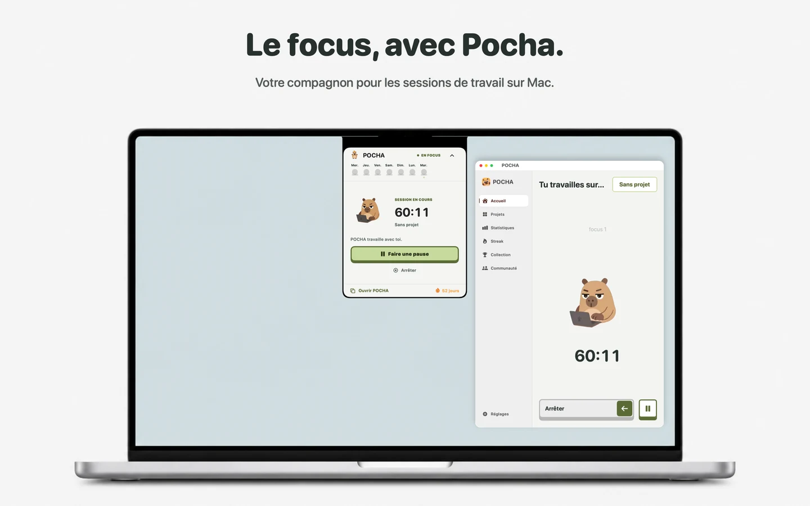
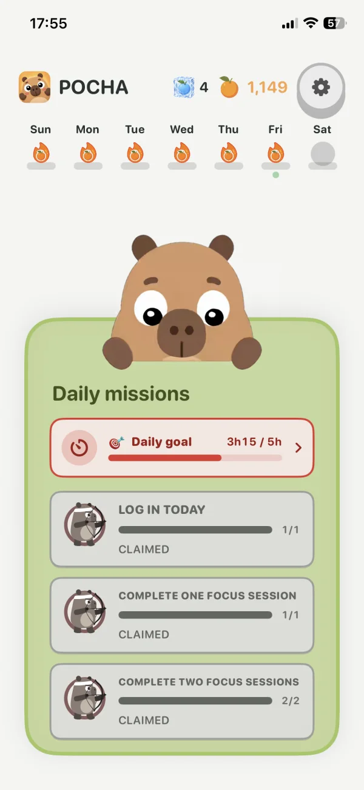
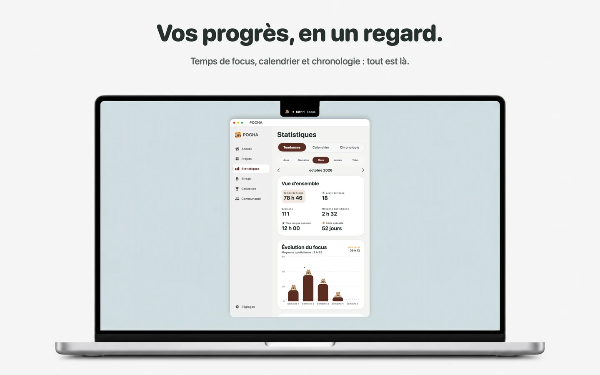
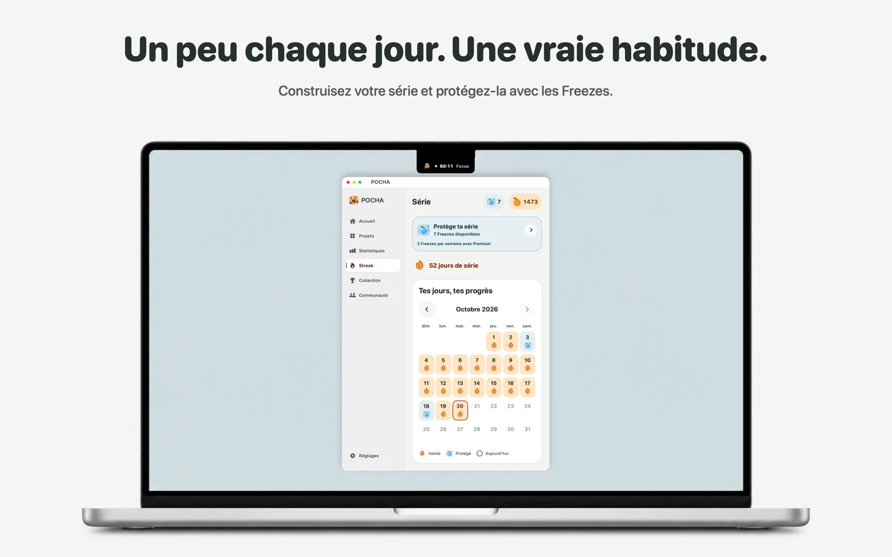

# Pomocha Landing Page

Ce site présente Pocha sur Mac, iPhone, iPad et Android, et [Pomocha sur le web](https://www.pomocha.io/).

🌐 **Déployé sur** : [www.pomocha.fr](https://www.pomocha.fr)

📱 **Pocha mobile** : [App Store](https://apps.apple.com/fr/app/pocha-minuteur-pomodoro/id6802377633) · [Google Play](https://play.google.com/store/apps/details?id=com.pocha.android)

## Aperçu de Pomocha.io

  

## Aperçus Mac

| Focus et Notch | Statistiques | Série |
| --- | --- | --- |
|  |  |  |

## URLs pour App Store Connect

Après déploiement :

| Champ | URL |
| --- | --- |
| URL marketing macOS | https://www.pomocha.fr/app#mac |
| URL d’assistance | https://www.pomocha.fr/support |
| Politique de confidentialité | https://www.pomocha.fr/privacy |
| Conditions et abonnements | https://www.pomocha.fr/terms |
| Licence standard Apple (EULA) | https://www.apple.com/legal/internet-services/itunes/dev/stdeula/ |
| Suppression du compte | https://www.pomocha.fr/delete-account |

Les pages sont accessibles sans compte et pré-rendues en HTML. Le site propose le français et l’anglais ; l’app propose 14 langues. Les anciens liens `/legal` de l’app donnent accès aux pages confidentialité et conditions. La disponibilité publique du Mac reste indiquée « bientôt » tant que la version est en préparation sur App Store Connect.

Sources Apple : [informations de version](https://developer.apple.com/help/app-store-connect/reference/app-information/platform-version-information), [confidentialité de l’app](https://developer.apple.com/help/app-store-connect/manage-app-information/manage-app-privacy). Ces pages accompagnent la fiche ; les déclarations de confidentialité et les informations de validation restent à renseigner dans App Store Connect selon le fonctionnement réel de l’app.
