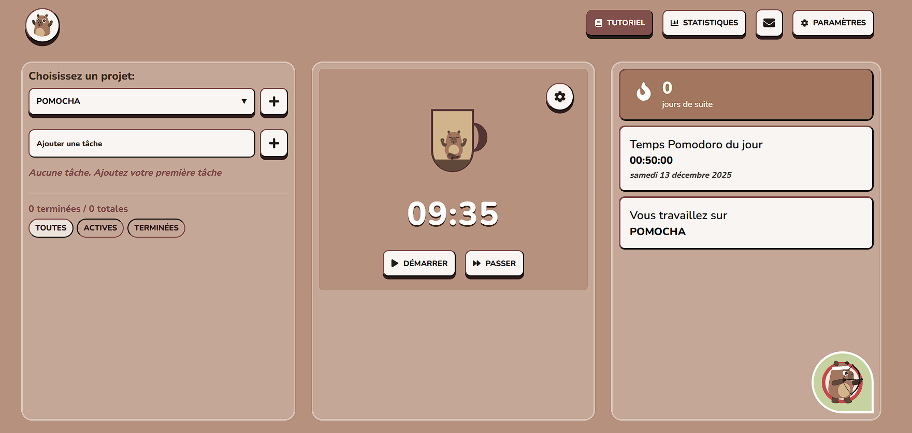
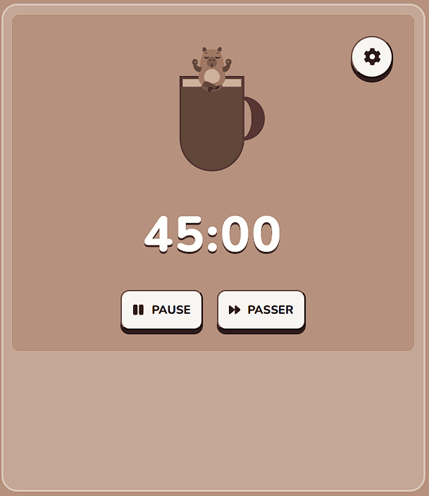
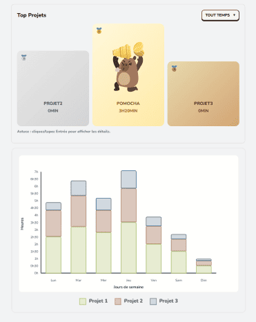
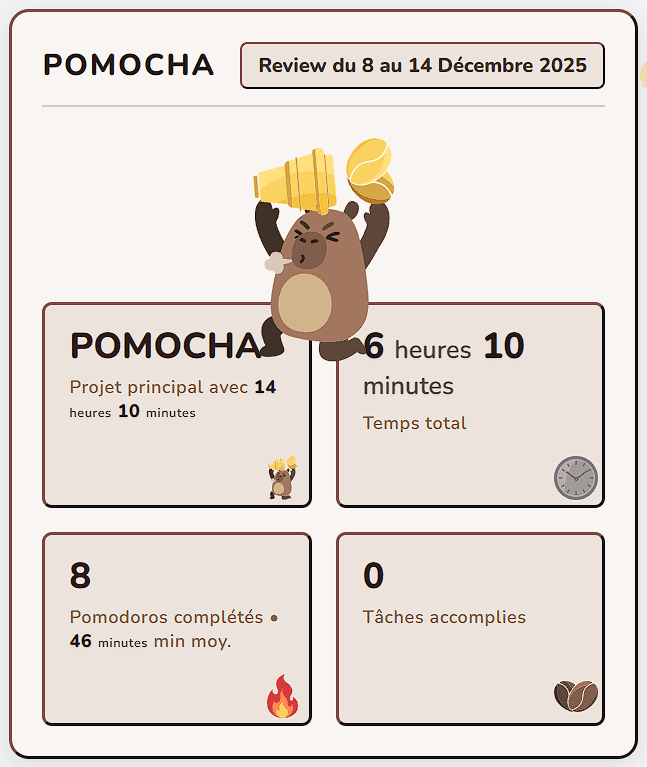
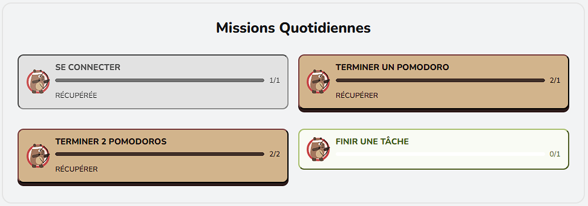
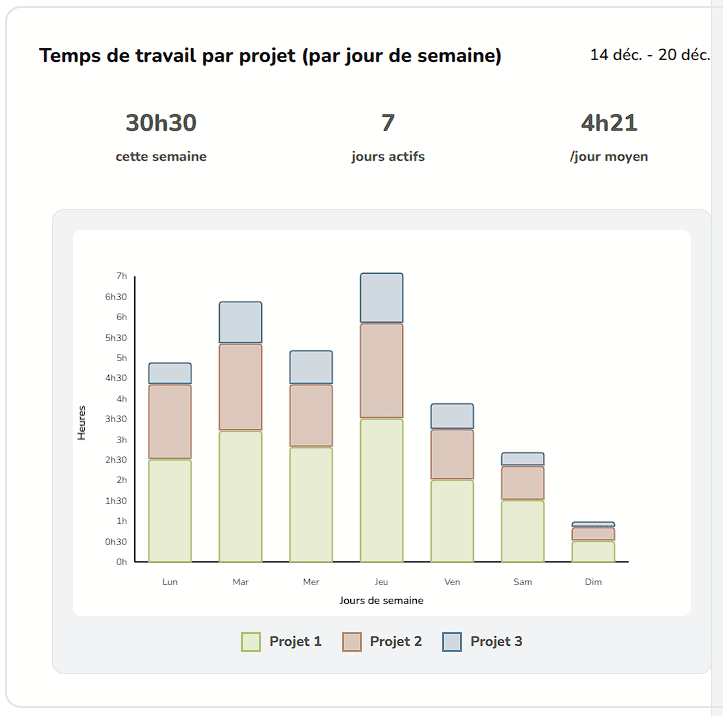
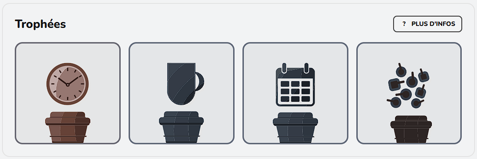

# Pomocha Landing Page

Ce site présente [Pomocha sur le web](https://www.pomocha.io/) et l'application mobile Pocha.

🌐 **Déployé sur** : [www.pomocha.fr](https://www.pomocha.fr)

📱 **Pocha mobile** : [App Store](https://apps.apple.com/fr/app/pocha-minuteur-pomodoro/id6802377633) · [Google Play](https://play.google.com/store/apps/details?id=com.pocha.android)

## Aperçu de Pomocha.io

  

## Fonctionnalités

| Timer | Statistiques | Sessions |
|:---:|:---:|:---:|
|  |  |  |

| Missions quotidiennes | Graphiques | Trophées |
|:---:|:---:|:---:|
|  |  |  |

